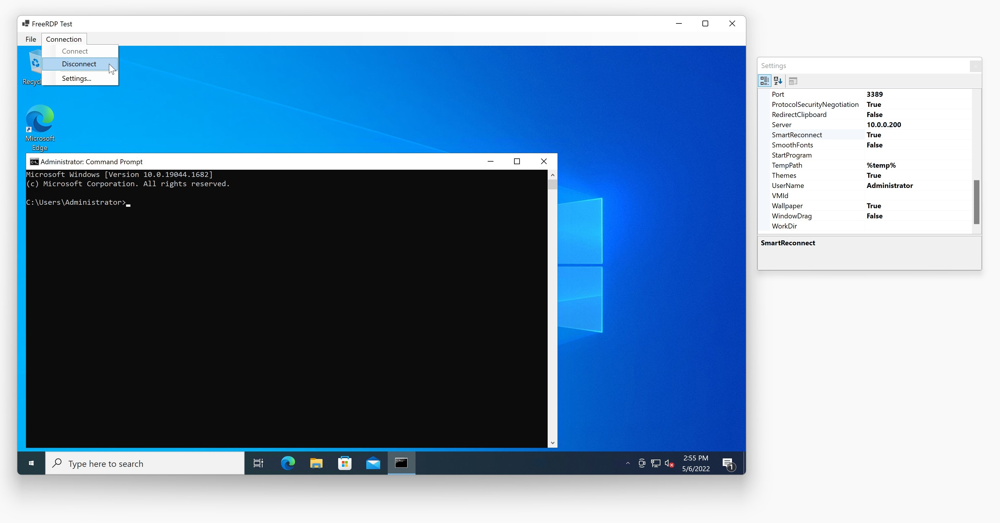

# FreeRDP Control

[](https://www.nuget.org/packages/RoyalApps.Community.FreeRdp.WinForms)
[](https://www.nuget.org/packages/RoyalApps.Community.FreeRdp.WinForms)
[](https://dotnet.microsoft.com/download)

`RoyalApps.Community.FreeRdp.WinForms` embeds [FreeRDP's Windows client](https://github.com/FreeRDP/FreeRDP) in a WinForms application. It launches `wfreerdp.exe` with a parent-window handle; it does not use Microsoft RDP ActiveX or FreeRdpKit.

- Typed destination, gateway, display, certificate, and redirection settings.
- A bundled client, with support for selecting a compatible custom executable.
- Connection events, credential/certificate retries, and resize/zoom reconnects.
- Opt-in native diagnostics with per-launch configuration and stdout/stderr capture, introduced in **2.2.4**.

The current source targets **.NET 10 and .NET 11 on Windows**. Older package releases may have different framework requirements.

## Documentation

The documentation can be found here:

- [Documentation site](https://royalapplications.github.io/royalapps-community-freerdp/)
- [Getting Started](https://royalapplications.github.io/royalapps-community-freerdp/articles/getting-started)
- [Configuration](https://royalapplications.github.io/royalapps-community-freerdp/articles/configuration)
- [Lifecycle and Events](https://royalapplications.github.io/royalapps-community-freerdp/articles/lifecycle)
- [Diagnostics](https://royalapplications.github.io/royalapps-community-freerdp/articles/diagnostics)
- [Troubleshooting](https://royalapplications.github.io/royalapps-community-freerdp/articles/troubleshooting)
- [Support Matrix](https://royalapplications.github.io/royalapps-community-freerdp/articles/support-matrix)
- [API Reference](https://royalapplications.github.io/royalapps-community-freerdp/api/)

See [documentation development and deployment](https://royalapplications.github.io/royalapps-community-freerdp/articles/contributing) to preview the site locally or publish it to GitHub Pages.



## Installation

```sh
dotnet add package RoyalApps.Community.FreeRdp.WinForms
```

For the diagnostics APIs, install version 2.2.4 or later from a feed containing that version.

## Quick start

On the WinForms UI thread, add the control to a form or container before connecting:

```csharp
using System.Windows.Forms;
using RoyalApps.Community.FreeRdp.WinForms;

// In your form's constructor, after initialization:
var rdp = new FreeRdpControl { Dock = DockStyle.Fill };
Controls.Add(rdp);
rdp.Configuration.Server = "desktop.example.test";

// Obtain credentials through your host application's secure credential flow.
rdp.Configuration.Username = username;
rdp.Configuration.Password = password;
Shown += (_, _) => rdp.Connect();
```

Use `rdp.Disconnect()` to stop the client. The containing form owns and disposes the control. Keep certificate validation enabled; see the guide before implementing certificate exceptions.

## Diagnostics

Set `DiagnosticsOptionsProvider` before connecting and subscribe to `DiagnosticOutput`. The provider is evaluated before every native launch, including internal retries.

Output is **raw and potentially sensitive**. Handlers must be thread-safe and nonblocking. The host owns redaction, bounded buffering, file writing, persistence, and enable/disable policy. See the [diagnostics guide](https://royalapplications.github.io/royalapps-community-freerdp/articles/diagnostics) for an integration example and lifecycle details.

## Demo and development

Open `src/RoyalApps.Community.FreeRdp.slnx` and run `RoyalApps.Community.FreeRdp.WinForms.Demo`.

```sh
dotnet build src/RoyalApps.Community.FreeRdp.slnx -c Release
dotnet test src/RoyalApps.Community.FreeRdp.WinForms.Tests/RoyalApps.Community.FreeRdp.WinForms.Tests.csproj -c Release
npm ci
npm run docs:dev
```

## Package publishing

The package workflow builds and tests both frameworks on pull requests and pushes to `main`. Only pushes to `main` publish to NuGet.org, using `NuGet/login` and a short-lived OIDC credential.

Sign in to NuGet.org as `StefanKoell` and create a [trusted publishing policy](https://www.nuget.org/account/trustedpublishing) with these settings:

| Field | Value |
| --- | --- |
| Policy name | Royal Apps Community FreeRDP |
| Package owner | RoyalApps |
| CI/CD provider | GitHub Actions |
| Repository owner | royalapplications |
| Repository | royalapps-community-freerdp |
| Workflow file | publish.yml |
| Environment | Leave empty |
| Scope | Push new packages and package versions |
| Glob patterns and packages | RoyalApps.Community.FreeRdp.* |

The workflow uses the organization Actions variable `NUGET_USER=StefanKoell`, which is already available to this repository. Create the policy before pushing the release changes to `main`. After the first successful publication, remove the old `NUGET_API_KEY` secret if no other workflow uses it. See the [NuGet trusted publishing guide](https://learn.microsoft.com/en-us/nuget/nuget-org/trusted-publishing) for details.

## License and acknowledgements

[MIT License](LICENSE). FreeRDP and other bundled dependencies retain their respective licenses.

Special thanks to [Marc-André Moreau](https://github.com/awakecoding) and [akallabeth](https://github.com/akallabeth) for their help.
